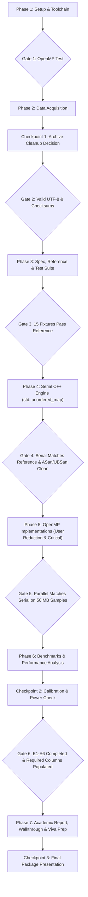

# Implementation Plan: Parallel Word Count & Text Processing with OpenMP

## 1. Project Overview & Context

- **Course:** Parallel and Distributed Computing (CS 3006), **FAST-NUCES Karachi Campus**
- **Team Member:** Ali Mahdi (Team of 3)
- **Project Topic:** #23 — Parallel Word Count / Text Processing using OpenMP
- **Goal:** Build an original, high-performance C++17 command-line program with OpenMP that counts word frequencies across multi-gigabyte UTF-8 datasets in English, Urdu, and Roman Urdu. Compare three paradigms:
  1. `serial`: Baseline single-threaded implementation.
  2. `critical`: Naive OpenMP parallelization with shared table protected by critical sections (contention demonstration; evaluated on a smaller sample to prevent pathological lock contention).
  3. `reduction`: Production OpenMP chunked parallelization using private per-thread hash tables combined via an **OpenMP user-defined reduction** (`#pragma omp declare reduction`). Any custom tree-based reduction is strictly a separate optional extra.
- **Hardware & Environment Profile:**
  - **Machine:** HP EliteBook 820 G4, Fedora Linux 44
  - **CPU:** Intel Core i5-7300U @ 2.60GHz (1 socket, 2 physical cores, 2 threads per core = 4 logical CPUs)
  - **CPU Scaling Governor:** Confirmed set to `performance` on all cores (`/sys/devices/system/cpu/cpu*/cpufreq/scaling_governor`).
  - **RAM:** 16 GB (hard limit of 12 GB enforced by polling peak RSS from `/proc/[pid]/statm` / `getrusage`, NOT `ulimit -v`).
  - **Storage:** Local NVMe SSD (`/dev/nvme0n1p3` mounted on `/home`), **408 GB available** (well above the 20 GB safety threshold).
  - **Project Directory:** `/home/iamblitz/Documents/PDC_Parallel_Keyword_and_Trend_Analyzer`
  - **Expected Scaling:** Strong scaling expected to level off around 2.0× to 2.5× due to 2 physical cores and hyper-threading limits; Karp-Flatt analysis and stage breakdown will accurately document and explain this behavior.

---

## 2. Operating Constraints & Rules of Engagement

1. **No Code / No Downloads Prior to Approval:** Approved by user on 2026-11-11; proceeding directly to Phase 1.
2. **Strict Non-Root Policy:** `sudo` will never be used. If any tool/library is missing, the exact Fedora `dnf` command will be provided to the user.
3. **Workspace Boundary:** All writes remain within `/home/iamblitz/Documents/PDC_Parallel_Keyword_and_Trend_Analyzer`.
4. **Data Integrity & Traceability:** No numbers in reports will be fabricated or hand-waved. Every metric is tied to a reproducible results CSV row. Failed runs and outliers will be recorded with notes.
5. **Code Originality & Clarity:** Code will be original, cleanly structured, and thoroughly commented to ensure every team member can explain every line in the viva examination.
6. **Data Structure Strategy:** Start with standard `std::unordered_map<std::string, uint64_t>` to establish a clean, idiomatic baseline before profiling.
7. **Git Version Control & Audit Trail:** A dated log file (`docs/work_log.md`) will record all decisions and commands; a Git commit will follow the successful completion of each phase. Ignore `data/samples/`, `data/raw/`, `data/decompressed/`, `venv/`, `build/`, `bin/`, and temporary results in `.gitignore`.

---

## 3. Seven-Phase Implementation Plan



---

### Phase 1: Setup & Environment Initialization

#### Tasks
1. Initialize local Git repository in `/home/iamblitz/Documents/PDC_Parallel_Keyword_and_Trend_Analyzer`.
2. Configure `.gitignore`:
   - Ignore `data/raw/`, `data/decompressed/`, `data/samples/`, `venv/`, `build/`, `bin/`, `*.tmp`, and benchmark dumps.
3. Verify toolchain versions:
   - GCC/G++ (`g++ 16.2.1`), OpenMP support (`-fopenmp`), Python (`3.14.10`), `fincore` (from `util-linux 2.41.6`), `git`, `make`.
4. Create organized directory structure:
   - `src/` (C++ source files: CLI driver, tokenizer, hash table, reduction, file reader)
   - `include/` (C++ header files)
   - `python/` (Python reference implementation, dataset preparation scripts)
   - `tests/` (15 hand-checked test fixtures, expected outputs, automated test runner)
   - `benchmarks/` (Benchmark runner, plotting scripts)
   - `docs/` (Specification, work log, environment dump, data report, report drafts)
   - `data/samples/` (50 MB dev/test samples; git-ignored)
   - `results/` (CSV logs, generated plots)
5. Create environment report file `docs/environment.md`:
   - Record `lscpu`, compiler flags, kernel version, RAM details, thread pinning defaults (`OMP_PROC_BIND=close`, `OMP_PLACES=threads`).
   - Record governor state (`performance` verified from `/sys/devices/system/cpu/cpu*/cpufreq/scaling_governor`).
   - Check `powerprofilesctl get` (if missing, note package `power-profiles-daemon` or sysfs confirmation).
6. Create initial audit log `docs/work_log.md`.
7. Compile and run a minimal OpenMP hello/reduction sanity program to confirm OpenMP threading and compiler flags.

#### Verification Gate 1
- Minimal OpenMP test program compiles with `-fopenmp -O3 -Wall -Wextra`, runs across 4 threads, and reports correct thread IDs and reduction sum.
- Git repository clean with initial commit.

---

### Phase 2: Dataset Acquisition & Preparation

#### Tasks
1. Verify storage headroom on local NVMe SSD (confirmed: 408 GB available, required: $\ge 20$ GB).
2. Download datasets with resumable tools (`curl -C -` or `wget -c` with retry loops):
   - **Urdu:** CC-100 `https://data.statmt.org/cc-100/ur.txt.xz` (~884 MB compressed, ~5-6 GB uncompressed)
   - **Roman Urdu:** CC-100 `https://data.statmt.org/cc-100/ur_rom.txt.xz` (~141 MB compressed, ~1 GB uncompressed)
3. Integrity-test downloaded archives with `xz -t` before decompression.
4. Decompress archives using safe two-step write (`ur.txt.tmp` $\to$ atomic rename to `ur.txt`) to prevent corrupt partial files if interrupted.
5. Set up dedicated Python virtual environment `venv/`:
   - Install `datasets` library without root.
   - Run stream-based extractor for Hugging Face `vblagoje/cc_news` (fallback to `cc_news` if needed), writing one article per line with collapsed whitespace to `data/decompressed/en_news.txt` (~2 GB).
6. Generate 50 MB sample files (`sample_ur.txt`, `sample_ur_rom.txt`, `sample_en.txt`) cleanly split at newline boundaries into `data/samples/` (git-ignored).
7. Generate `docs/data_report.md` detailing:
   - Exact byte sizes and line counts for all files and samples.
   - `file -i` output confirming UTF-8 encoding.
   - Hex/character dump of the first 500 bytes of each file.
   - Compute and record SHA-256 checksums in `data/checksums.sha256`.

#### Checkpoint 1
- **Action:** Halt execution and present the data report with exact file sizes, line counts, and free disk space.
- **Decision requested from user:** Confirm whether raw compressed `.xz` archives and Hugging Face cache files should be removed to reclaim disk space or retained for safety.

#### Verification Gate 2
- All three full datasets and three 50 MB samples exist, are non-empty, and validate cleanly as UTF-8.
- SHA-256 checksum file is committed to Git.

---

### Phase 3: Tokenization Specification, Reference Implementation & Test Suite

#### 3.1 Tokenization Specification (`docs/counting_rules.md`)
- **Explicit Separation Rules (No Unicode-category lookups):**
  - **ASCII Token Characters:** `a-z`, `A-Z`, `0-9`.
  - **ASCII Separators:** Every ASCII character that is not a letter or digit (space `0x20`, `\t` `0x09`, `\n` `0x0A`, `\r` `0x0D`, punctuation, symbols).
  - **Hashtag Exception:** `#` (`0x23`) immediately followed by an ASCII letter/digit or non-ASCII token character is retained as part of the token. An isolated `#` is treated as a separator.
  - **Explicit Non-ASCII Separators:**
    - Non-breaking space (`U+00A0`)
    - Arabic/Urdu punctuation: Arabic comma (`U+060C`), Arabic semicolon (`U+061B`), Arabic question mark (`U+061F`), Urdu full stop (`U+06D4`), Arabic percent sign (`U+066A`), Arabic decimal separator (`U+066B`), Arabic thousands separator (`U+066C`)
    - General typographical punctuation: Typographic single/double quotes (`U+2018`, `U+2019`, `U+201A`, `U+201B`, `U+201C`, `U+201D`, `U+201E`, `U+201F`), dashes (en-dash `U+2013`, em-dash `U+2014`, horizontal bar `U+2015`), ellipsis (`U+2026`).
  - **Non-ASCII Token Characters:** Every other non-ASCII character (not explicitly listed as a separator or stripped) is strictly treated as a valid token character.
  - **Transparently Stripped (Ignored without splitting tokens):**
    - Zero-Width Non-Joiner (ZWNJ `U+200C`)
    - Zero-Width Joiner (ZWJ `U+200D`)
    - Byte Order Mark (BOM `U+FEFF`)
    - Arabic diacritics / harakat (`U+064B` through `U+065F`, and `U+0670`)
  - **Normalization:**
    - ASCII uppercase `A-Z` $\to$ lowercase `a-z`.
    - Arabic Yeh (`U+064A`) $\to$ Urdu Yeh (`U+06CC`).
    - Arabic Kaf (`U+0643`) $\to$ Urdu Kaf (`U+06A9`).
  - **Error Handling & Size Limits:**
    - Invalid UTF-8 byte sequences are treated as word separators.
    - Tokens strictly exceeding 64 bytes are skipped.
  - **Counters:** 64-bit unsigned integers (`uint64_t`).

#### 3.2 Canonical Checksum Formula
To ensure deterministic, order-independent verification across serial and multi-threaded parallel runs without dumping multi-gigabyte files, we define **exactly one checksum formula**:
1. For each normalized token string $w_k$, compute 64-bit FNV-1a hash:
   $$\text{hash} = \text{0xcbf29ce484222325ULL}$$
   $$\forall b \in w_k: \quad \text{hash} = (\text{hash} \oplus b) \times \text{0x100000001b3ULL}$$
2. Mix the hash with the 64-bit word count $c_k$ using Murmur/SplitMix 64-bit constant:
   $$\text{term}(w_k, c_k) = \text{hash} \oplus (c_k \times \text{0x9e3779b97f4a7c15ULL})$$
3. The total table checksum is the commutative sum modulo $2^{64}$:
   $$\text{Checksum} = \sum_{k=1}^{U} \text{term}(w_k, c_k) \pmod{2^{64}}$$

Because addition modulo $2^{64}$ is commutative and associative, the checksum is strictly invariant to hash table iteration order.

#### 3.3 Hand-Checked Expected Outputs for All 15 Test Fixtures

| Fixture File | Input Content / Characteristic | Hand-Checked Expected Output (Token: Count) |
| --- | --- | --- |
| `01_plain_english.txt` | `apple banana apple cherry banana apple` | `apple: 3`, `banana: 2`, `cherry: 1` |
| `02_mixed_case.txt` | `Hello hello HELLO World world` | `hello: 3`, `world: 2` |
| `03_hashtags.txt` | `#urdu #PDC2026 # 100 #100 #urdu` | `#urdu: 2`, `#pdc2026: 1`, `100: 1`, `#100: 1` *(isolated `#` ignored)* |
| `04_urdu_punctuation.txt` | `کتاب، قلم؛ کاپی؟ کتاب۔` | `کتاب: 2`, `قلم: 1`, `کاپی: 1` |
| `05_arabic_diacritics.txt` | `کِتَاب کَتَاب کُتّاب کتاب` *(with Kasrah, Fathah, Dammah, Shaddah)* | `کتاب: 4` *(all diacritics stripped transparently)* |
| `06_joiners.txt` | `دل‌چسپ دل‍چسپ دلچسپ` *(ZWNJ U+200C and ZWJ U+200D)* | `دلچسپ: 3` *(joiners stripped without splitting)* |
| `07_yeh_kaf_mapping.txt` | `كتاب يہ کتاب یہ` *(Arabic Kaf U+0643 + Arabic Yeh U+064A vs Urdu)* | `کتاب: 2`, `یہ: 2` *(normalized to Urdu Kaf U+06A9 & Urdu Yeh U+06CC)* |
| `08_roman_urdu.txt` | `kya haal hai bhai kya haal` | `haal: 2`, `kya: 2`, `bhai: 1`, `hai: 1` |
| `09_long_tokens.txt` | `short aaaaaaaaaaaaaaaaaaaaaaaaaaaaaaaaaaaaaaaaaaaaaaaaaaaaaaaaaaaaaaaaa (65 'a's) short` | `short: 2` *(65-byte token skipped)* |
| `10_invalid_utf8.txt` | `valid \xFF\xFE invalid\x80token valid` | `valid: 2`, `invalid: 1`, `token: 1` *(invalid bytes act as delimiters)* |
| `11_empty_lines.txt` | `\n\n\nword\n\n   \n\nword\n\n` | `word: 2` |
| `12_crlf_windows.txt` | `line1\r\nline2\r\nline1\r\n` | `line1: 2`, `line2: 1` |
| `13_missing_final_newline.txt` | `first second second` *(no trailing `\n`)* | `second: 2`, `first: 1` |
| `14_single_token.txt` | `solitary` | `solitary: 1` |
| `15_multibyte_boundary.txt` | `پاکستان، #پاکستان! پاکستان؟` | `پاکستان: 2`, `#پاکستان: 1` |

#### 3.4 Python Reference & Automated Test Harness
- Implement `python/reference_counter.py` strictly following the specification.
- Implement `python/test_runner.py` to run all 15 fixtures and verify outputs against the hand-checked ground truth table.

#### Verification Gate 3
- The Python reference implementation passes all 15 fixtures with 100% agreement against the hand-checked ground truth table.
- Deterministic CSV sorting and 64-bit canonical checksum verified.

---

### Phase 4: High-Performance Serial C++ Engine

#### Tasks
1. Build core C++ modules in `src/` starting with standard, readable structures:
   - `tokenizer.hpp` / `.cpp`: UTF-8 direct byte scanning tokenizer following `docs/counting_rules.md`. No heavy regex.
   - `frequency_table.hpp`: Baseline implementation using `std::unordered_map<std::string, uint64_t>`.
   - `checksum.hpp`: Single canonical 64-bit checksum computation.
   - `output_writer.hpp`: Deterministic CSV output writer (sorted descending by count; ties broken lexicographically by raw UTF-8 bytes).
   - `file_reader.hpp`: Memory-mapped file I/O (`mmap` with `posix_fadvise(POSIX_FADV_DONTNEED)` for cold-cache runs).
2. Build serial executable CLI (`bin/wordcount_serial`):
   - Command-line arguments: `--input`, `--mode serial`, `--top N`, `--output-dir`, `--log-file`, `--dump-all`, `--cold-cache`, `--max-mb`.
   - Stage timing via `omp_get_wtime()`: reading, tokenizing/counting, output writing, total.
3. Establish build configurations:
   - **Release:** `g++ -O3 -std=c++17 -Wall -Wextra -fopenmp`
   - **Sanitizers (Primary):** `g++ -O1 -g -std=c++17 -Wall -Wextra -fopenmp -fsanitize=address,undefined` (ASan + UBSan)
   - **TSan (Optional):** `-fsanitize=thread` available as a separate non-blocking build target (`make tsan`).
4. Validate serial output against Python reference:
   - Run on all 15 synthetic test files with `--dump-all`.
   - Run on the three 50 MB sample files (`sample_ur.txt`, `sample_ur_rom.txt`, `sample_en.txt`).
5. Measure baseline serial runtime on 1 GB Urdu and complete Urdu dataset; save results to `results/serial_baseline.csv`.

#### Verification Gate 4
- Serial C++ engine produces byte-identical CSV dumps and identical 64-bit checksums compared to the Python reference across all 15 test fixtures and all three 50 MB samples.
- ASan + UBSan build passes with zero memory leaks, buffer overruns, or undefined behavior.
- Baseline serial execution times recorded.

---

### Phase 5: Parallel OpenMP Implementations (User Reduction & Critical)

#### Tasks
1. **Chunking Rule & OpenMP Loop Iterations:**
   - The chunk size $C$ in bytes is configured independently of the thread count.
   - Chunks constitute the iterations of an OpenMP parallel loop:
     `#pragma omp parallel for schedule(dynamic, 1) reduction(TableMerge:table)` (or `static, 1`, `guided, 1`).
   - Nominal boundary: $b = k \cdot C$.
   - Boundary adjustment function `adjust(b)`:
     - $\text{adjust}(0) = 0$.
     - $\text{adjust}(\text{file\_size}) = \text{file\_size}$.
     - For $0 < b < \text{file\_size}$, $\text{adjust}(b)$ moves to the first byte position $p \ge b$ such that $\text{byte}[p - 1]$ is ASCII whitespace (`0x20`, `0x09`, `0x0A`, `0x0D`).
     - Chunk $k$ strictly covers the byte slice:
       $$[\text{adjust}(k \cdot C), \; \text{adjust}((k + 1) \cdot C))$$
   - Because whitespace bytes never appear as continuation bytes in UTF-8, this strictly partitions the byte stream without splitting words or characters.
2. **Main Parallel Version: OpenMP User-Defined Reduction:**
   - Each thread counts into its own private `std::unordered_map<std::string, uint64_t>` kept on separate cache lines (`alignas(64)` structure) to prevent false sharing.
   - Combine thread tables using OpenMP User-Defined Reduction:
     ```cpp
     #pragma omp declare reduction(TableMerge : FrequencyTable : omp_out.merge(omp_in)) \
         initializer(omp_priv = FrequencyTable())
     ```
   - Any manual tree-based reduction is reserved strictly as a separate optional experiment.
3. **Contention Demonstration: Critical Section Version:**
   - Threads update one shared table guarded by `#pragma omp critical`.
   - **Evaluated on a smaller dataset piece** (e.g., 100 MB or 256 MB) to demonstrate the severe performance penalty of lock contention without causing unmanageable runtimes.
4. **Cache Control Verification:**
   - Use `fincore` to verify that `posix_fadvise(POSIX_FADV_DONTNEED)` successfully evicts file pages from page cache before cold-cache benchmark runs.
5. **Memory Cap Enforcement:**
   - Enforce the 12 GB memory limit by polling peak RSS from `/proc/[pid]/statm` / `getrusage`, NOT `ulimit -v`.
6. Multi-thread correctness verification matrix:
   - Threads: 1, 2, 3, 4, 8
   - Chunk sizes: 64 KB, 1 MB, 16 MB
   - Schedules: `static`, `dynamic`, `guided`
   - **Run on the 50 MB sample files.**

#### Verification Gate 5
- Word counts, top-N words, and canonical 64-bit checksums in `reduction` match `serial` bit-for-bit across all thread counts, schedules, and chunk sizes **on the 50 MB samples**.
- ASan + UBSan build passes cleanly.
- Parallel `reduction` at 2 threads demonstrates measurable speedup over `serial` ($S > 1.0\times$).

---

### Phase 6: Rigorous Benchmarking & Performance Analysis

#### Tasks
1. Develop automated benchmark orchestrator `benchmarks/run_benchmarks.py`:
   - Warm-up protocol: 1 discarded warm-up run + 5 timed repetitions per configuration.
   - Interleaved execution order across thread counts to prevent thermal bias.
   - Thread pinning: `OMP_PROC_BIND=close`, `OMP_PLACES=threads`.
   - Eviction verification with `fincore` for cold-cache runs.
   - 15-minute timeout per run.
   - Enforce 12 GB memory cap by polling peak RSS.
   - Record metrics: median time, minimum time, spread, speedup, efficiency (logical & 2-core physical), throughput (MB/s), peak memory (RSS via `getrusage`), and Karp-Flatt serial fraction.
2. Calibrate runtime and establish Primary Size:
   - Test 1 GB, 2 GB, 4 GB, full Urdu, and full combined dataset.
   - Select smallest input with serial runtime $\ge 60$ seconds as the Primary Size.
   - Calculate total benchmark execution time estimate.

#### Checkpoint 2
- **Action:** Present calibration results, chosen Primary Size, and total runtime estimate to the user.
- **System checks:**
  - Verify laptop is on AC power and idle.
  - Read power profile: execute `powerprofilesctl get` (or record `performance` governor from sysfs if `powerprofilesctl` is missing).
  - Record power configuration in `docs/environment.md`.

#### Tasks (Post-Checkpoint 2 Benchmark Execution)
Run experiments E1 through E6:
- **E1: Strong Scaling:** Primary size, `reduction` mode, `dynamic` schedule, 16 MB chunks, threads: 1, 2, 3, 4, 6, 8 (warm cache). Includes serial baseline and stage breakdown (read, count, merge, write).
- **E2: Implementation Comparison:** Serial vs. Critical vs. Reduction at 2 and 4 threads on a smaller piece (100 MB or 256 MB) to safely demonstrate lock contention.
- **E3: Schedule & Chunk Size:** Static, Dynamic, Guided $\times$ chunk sizes (1 MB, 4 MB, 16 MB, 64 MB) at 2 and 4 threads on 1 GB Urdu.
- **E4: Input Size Scaling:** Urdu dataset prefixes (256 MB, 512 MB, 1024 MB, 2048 MB, 4096 MB, and full file) at 1 and 4 threads.
- **E5: Cache Impact (Cold vs. Warm):** 1 GB piece and Primary Size at 1, 2, and 4 threads comparing warm cache vs. `fincore`-verified cold cache.
- **E6: Multilingual Characteristics:** Full Urdu, Roman Urdu, and English datasets at 1 and 4 threads; measure throughput, memory footprint, and unique vocabulary density.
3. Build plot generator `benchmarks/generate_plots.py` (using `matplotlib`):
   - Generate publication-quality PNG charts with error bars:
     1. Execution Time vs. Threads (E1)
     2. Speedup vs. Threads with Linear Ideal Baseline (E1)
     3. Efficiency vs. Threads (E1, relative to 2 physical cores & 4 threads)
     4. Implementation Comparison Bar Chart (E2: Serial vs. Critical vs. Reduction)
     5. Schedule and Chunk Size Comparison (E3)
     6. Input Size vs. Execution Time & Throughput (E4)
     7. Cold vs. Warm Cache Comparison (E5)
     8. Multilingual Throughput & Unique Token Density (E6)
     9. Stacked Stage Breakdown Bar Chart (Read, Tokenize/Count, Merge, Output)

#### Verification Gate 6
- Every required column in `results/benchmark_master.csv` populated from complete 5 repetitions; zero hardcoded numbers.
- All parallel checksums match serial checksums identically.
- All 9 plot figures generated cleanly with labeled axes, error bars, and source data citations.

---

### Phase 7: Academic Report, Code Walkthrough & Viva Preparation

#### Tasks
1. Package root `README.md`:
   - Exact one-command build instructions (`make release`, `make test`, `make bench`).
   - Clear CLI documentation and options overview.
2. Produce comprehensive code walkthrough `docs/code_walkthrough.md`:
   - Line-by-line explanation of core C++ modules.
   - Deep dive into chunking boundary safety for UTF-8 (`adjust(k * C)` rule).
   - Mechanics of the OpenMP user-defined reduction (`#pragma omp declare reduction`).
   - Race condition prevention and cache-line separation (`alignas(64)`) to eliminate false sharing.
   - Trade-offs between `static`, `dynamic`, and `guided` scheduling.
3. Produce viva preparation guide `docs/viva_preparation.md`:
   - Minimum 25 anticipated viva examination questions with concise, technically rigorous answers tailored to this specific code and hardware.
   - Detailed talking points on Amdahl’s Law, Karp-Flatt metric, memory bus bandwidth saturation, and the physical 2-core / 4-thread architecture of the i5-7300U.
4. Draft final academic report `docs/project_report.md`:
   - Abstract, Introduction, Problem Formulation, Architectural Design.
   - Experimental Methodology and System Specifications (FAST-NUCES Karachi Campus).
   - Comprehensive Results Analysis with embedded figures and captions tied directly to CSV data rows.
   - Theoretical Analysis: Amdahl's Law limit, Karp-Flatt serial fraction, stage timing bottlenecks, I/O bound vs. compute bound regimes, hyper-threading efficiency decay.
   - Limitations and Conclusions.

#### Checkpoint 3
- **Action:** Present the complete deliverable suite (README, code walkthrough, viva guide, and draft academic report) for team review and final feedback.

---

## 4. Deliverables Checklist & Definition of Done

| Deliverable | Location / Artifact | Criteria for Done |
| --- | --- | --- |
| **C++ Executable & Build System** | `src/`, `include/`, `Makefile` | Builds with one command (`make`), zero compiler warnings (`-Wall -Wextra`), ASan/UBSan clean. |
| **Reference & Test Suite** | `python/`, `tests/` | 15 corner-case test files, automated test harness passing 100% against hand-checked ground truth table. |
| **Raw Datasets & Manifest** | `data/`, `docs/data_report.md` | Full Urdu, Roman Urdu, and English datasets; 50 MB test samples; SHA-256 verified. |
| **Benchmark Engine & Results** | `benchmarks/`, `results/*.csv` | Fully automated runner; 5 repetitions + warmup; 100% checksum consistency across runs; required columns populated. |
| **Visual Performance Artifacts** | `results/*.png` | 9 high-resolution PNG plots with error bars, labeled axes, and ideal comparison lines. |
| **System Walkthrough & Viva Prep** | `docs/code_walkthrough.md`, `docs/viva_preparation.md` | Plain-English explanation of all code constructs; 25+ targeted viva defense questions answered. |
| **Final Academic Report** | `docs/project_report.md` | Complete academic report for FAST-NUCES with all figures captioned and numbers linked to source rows. |

---

## 5. Summary of Checkpoints Requiring User Input

1. **Checkpoint 1 (Post-Phase 2 Data Acquisition):** Review downloaded file sizes and confirm whether compressed `.xz` archives and HF cache may be deleted to save disk.
2. **Checkpoint 2 (Pre-Phase 6 Full Benchmarking):** Review calibration runtime and total time estimate; verify laptop is plugged in, set to performance mode, and idle; record power profile.
3. **Checkpoint 3 (Post-Phase 7 Final Review):** Review complete report package, viva guide, and code walkthrough.
